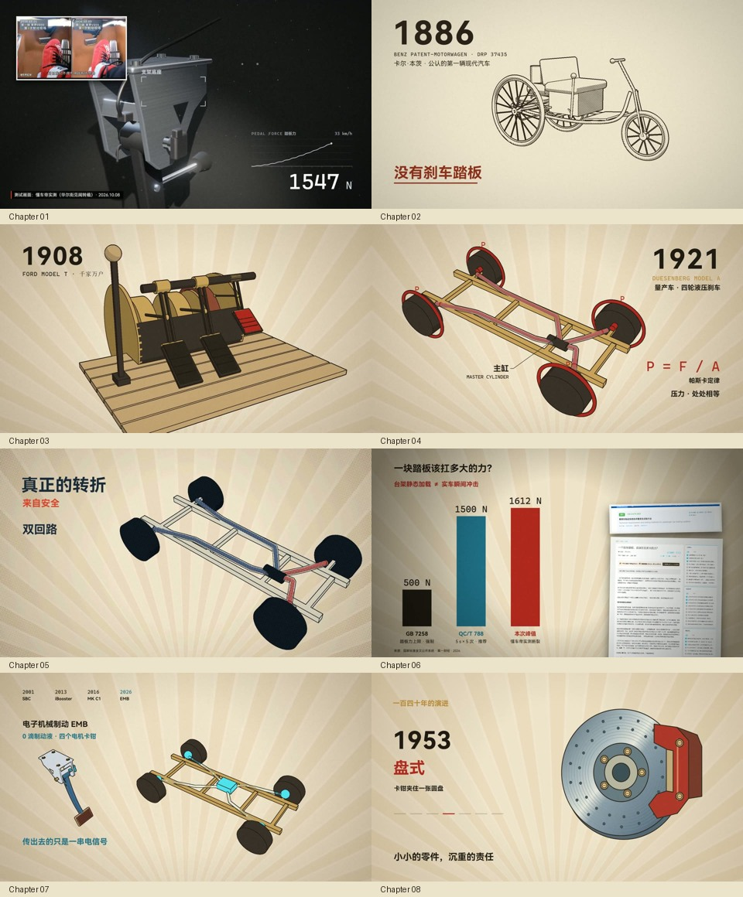

# Code Video Lab：从研究到成片的纯代码视频

这是 Awei 在 Cursor 中发起、多模型协作完成的《刹车踏板进化史》工程，也是一个可供其他模型学习的完整案例。它展示的不是“让模型写几段动画代码”，而是资料搜集、事实表、口播、分镜、美术、程序化建模、声音、逐帧渲染和反复审片之间的连接。

**最值得学习的是 Opus5.5 建立的全链路能力，以及第一、第二章的物体建模和美术设计。** 后续章节由 Opus 完成骨架后，Grok4.7 接手完善；GPT-6.1 参与第八章重设计、胶片与打字机效果、声音替换和工程整理。分工依据作者回溯，详见 [项目复盘](docs/MAKING_OF.md)。



## 从哪里开始读

- 给模型直接用：[skills/code-video/SKILL.md](skills/code-video/SKILL.md)。可把整个 `code-video` 文件夹复制到支持 `SKILL.md` 的代理技能目录。
- 想理解“为什么这样做”：[制作复盘](docs/MAKING_OF.md)。记录参考、模型协作、审片改动和可迁移的经验。
- 想理解“怎样画出来”：[架构与代码导览](docs/ARCHITECTURE.md)。优先读 `ch1.js`、`ch2.js` 与程序化模型。
- 想在本机运行或换主题：[运行与复用](docs/REUSE.md)。包括抽帧、章节渲染、TTS 和配音替换。
- 案例输入：[brief](opus-video/brake-pedal-history/brief.md)、[口播稿](opus-video/brake-pedal-history/script.md)、[当前分镜](opus-video/brake-pedal-history/storyboard.md)、[时间轴](opus-video/brake-pedal-history/timeline.json)。

## 工程结构

```text
skills/code-video/                 可复用制作 skill；渲染、音频、检查脚本
  SKILL.md
  references/                      工艺标准、方案和 brief 模板
  scripts/
docs/                              制作复盘、架构、运行指南
  gallery/                         精选八章画面
  archive/                         标记为历史版本的分镜
opus-video/brake-pedal-history/     完整案例
  index.html                       window.render(t) 入口
  src/scenes/                      八章、封面、结尾机械插画
  src/three/                       程序化模型、相机与渲染风格
  src/lib.js                       弹簧、文字、转场和固定种子纹理
  tools/                           案例时间轴、抽帧、TTS、混音工具
  source/                          事实表、真实截图来源索引
  assets/fonts/                    可选本地字体说明
  audio/vo/segments.example.json    不含音色身份的口播配置示例
  previews/ qa/ audio/ out/         本地运行产物，不进入 Git
licenses/                          第三方许可证
```

只保留一个 `previews/` 工作目录；`out/` 只放交付与分章成片。代表性静帧属于 `docs/gallery/`，无需在源码库中堆叠所有 v1、v2 和临时版本。

## 快速运行

需要 Python 3.10+、FFmpeg 和 Chromium。查看或重建 Three.js bundle 时需要 Node.js。

```powershell
python -m pip install -r requirements.txt
python -m playwright install chromium
python skills/code-video/scripts/check_env.py
cd opus-video/brake-pedal-history
python tools/stills.py demo 65 148 251 397
```

打开案例 `index.html` 可以检查画面；在浏览器控制台调用 `window.render(65)`，65 是**正文时间轴**的绝对秒。本地最终交付另加了 2 秒封面片头，因此成片中的同一画面在约 67 秒。公共源码使用系统字体兜底，新闻原图缺失时显示明确的截图占位，详情见 [复现说明](docs/REUSE.md)。

## 制作中的关键选择

画面由 Canvas、Three.js 与自写着色器生成；相机、模型姿态、粒子、弹簧和光标均由 `t` 计算。初始化可以缓存几何与纹理，但不能靠前一帧推进动画。

物体先按机械结构拆解，再建立支点、转轴、连杆、踏面、螺栓、加强筋和安装关系。材质、灯光、排线、墨线和镜头服务于讲解，不用几个长方体代替全部机械结构。

口播与音乐可独立替换，画面先抽帧审核，再正式渲染。对已完成的影片换声时，以原录音为节奏参照，保留气口与原章节时长，不重新排整个时间轴。

本案例的主体动画是纯代码。真实新闻截图是事实举证的明确例外；最终封面按作者要求使用了 imagegen。最终版本只保留口播，代码合成配乐脚本仍作为可选能力保留。不要把这些例外描述成“全片所有像素与声音都纯代码合成”。

## 参考与贡献

创作入口是 [@xilo2991 的教程](https://x.com/xilo2991/status/2104912748794589515)，电影感参考为 [@prasenx 的推文](https://x.com/prasenx/status/2103851939457093635)，后续动效方法参考 [mg-styles-15](https://github.com/Vincentwei1021/mg-styles-15)。基础制作 skill 来自 [xilo-opus-video](https://github.com/Kianzzz/xilo-opus-video)。

Awei 负责选题、参考、审片和创作决策；Opus5.5、Grok4.7、GPT-6.1 是协作制作工具。它们在此项目中的分工不是跨模型性能评测，也不是逐行代码署名。

原创代码和文档采用 MIT。公开仓库不包含本地声纹样本、克隆口播、完整 MP4、商业字体或新闻原图；代码、截图索引、构建入口和精选案例图用于学习与复现。[完整来源说明](THIRD_PARTY_NOTICES.md)。
