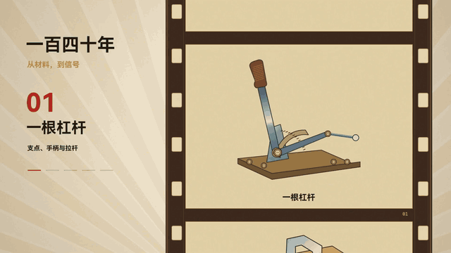
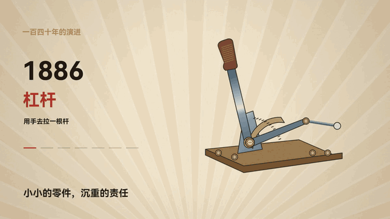

# Code Video Lab：从研究到成片的纯代码视频

**一个完整的代码视频制作案例，连接资料研究、叙事、程序化建模、美术设计、口播和逐帧渲染。**

[简体中文](README.md) · [English](README.en.md)

案例是一部约七分钟的汽车刹车踏板进化史科普片。画面组合了 Canvas、Three.js、自写着色器、机械剖面、铜版画排线和确定性动画。

工程由 **Awei 在 Cursor 中发起**，记录了 **Opus5.5** 建立的全链路基础、**Grok4.7** 接手后续章节，以及 **GPT-6.1** 完成收尾的协作过程。第一、第二章尤其适合学习程序化建模与统一的美术语言。

[查看／下载约 25 秒无声合集](docs/gallery/code-video-showreel.mp4) · [可复用 agent skill](skills/code-video/SKILL.md) · [制作复盘](docs/MAKING_OF.md)

## 动态画面精选

### 铜版画汽车，从线稿中出现

1886 年奔驰专利车随着裁剪面移动逐步显现。程序化车轮、连杆和车身配合墨线与交叉排线，建立历史机械的画面语言。


代码入口：[第二章](opus-video/brake-pedal-history/src/scenes/ch2.js) · [历史模型](opus-video/brake-pedal-history/src/three/models_history.js) · [渲染舞台](opus-video/brake-pedal-history/src/three/stage.js)

### 机械进化，一格一格经过胶片

杠杆、木质刹车块、钢板臂、复合材料铺层和传感器各占一个片格。齿孔、边界和插画共享片带位移，曝光闪烁也由时间求值。



代码入口：[第八章](opus-video/brake-pedal-history/src/scenes/ch8.js) · [原创机械插画](opus-video/brake-pedal-history/src/scenes/ch8-art.js)

### 左侧换年代，右侧换机构

年份与说明随右侧完整机械组件同步变化：杠杆、三踏板、液压、盘式、ABS、线控和 EMB，逐格向上轮播。



### 有字形、有重量的打字机结尾

大号暖朱红宋体逐字弹簧落下，快速回删，再输入下一句。光标跟随实际字宽移动；原片最后缓慢淡黑。


以上为从成片截取并压缩的无声片段，GIF 适合 README 展示；合集 MP4 保留较高分辨率，方便社交平台分享。完整成片和克隆口播不包含在公开源码中。

## 完整制作链路

```text
研究与出处 → 口播 → brief 与分镜
        → 程序化资产＋美术方向 → 确定性场景
        → 预览与审片 → 声音对齐 → 逐帧渲染 → 交付
```

仓库保留了实现，也保留了实现背后的决策：

- **结构先于装饰。** 支点、转轴、支架、曲线臂、踏面、推杆、螺栓与加强筋共同表达功能。
- **美术覆盖整个镜头。** 材料、灯光、机位、轮廓、排线、文字和过渡形成统一画面。
- **每帧可独立定位。** `window.render(t)` 决定完整画面，固定种子与闭式弹簧支持乱序渲染。
- **声音是时间约定。** 换音色时保护原章节时长和气口，用声学参照和保持音高的变速对齐，不把它当成转录。
- **先审片，再长时间渲染。** 检查代表帧、动作极值、转场连续帧和手机尺寸可读性。

## 模型协作分工

**Opus5.5** 建立项目框架、分镜、美术方向和各章骨架。第一、第二章基本由其完成，包括细致的踏板总成和铜版画历史车辆。

**Grok4.7** 在骨架建立后接手后续章节，持续完善模型、构图、颜色、过渡和可读性。

**GPT-6.1** 参与第八章重设计、独立机械插画、胶片与打字机效果、配音替换和工程整理。

**Awei** 负责选题、参考、审片和创作决策。以上分工依据作者回溯，不等同于逐行代码归属或跨模型性能评测。

## 阅读入口

- [制作 skill](skills/code-video/SKILL.md)：可将整个 `code-video` 文件夹复制到支持 SKILL.md 的代理技能目录。
- [项目复盘](docs/MAKING_OF.md)：参考、协作、审片迭代与经验。
- [架构导览](docs/ARCHITECTURE.md)：场景、建模、着色器和时间工具的阅读顺序。
- [运行与复用](docs/REUSE.md)：预览、渲染、TTS 和配音替换。
- 案例输入：[brief](opus-video/brake-pedal-history/brief.md)、[口播稿](opus-video/brake-pedal-history/script.md)、[分镜](opus-video/brake-pedal-history/storyboard.md)、[时间轴](opus-video/brake-pedal-history/timeline.json)。

详细制作笔记和案例口播保留中文；两版 README 展示同一个工程与同一组代码。

## 快速运行

需要 Python 3.10+、FFmpeg 和 Chromium。只有重建仓库已附带的 Three.js bundle 时才需要 Node.js。

```sh
python -m pip install -r requirements.txt
python -m playwright install chromium
python skills/code-video/scripts/check_env.py
cd opus-video/brake-pedal-history
python tools/stills.py demo 65 148 251 397
```

浏览器入口为 index.html，`window.render(65)` 表示正文第 65 秒。本地交付额外添加两秒封面，因此同一画面出现在影片约第 67 秒。

字体提供系统兜底；缺少新闻原图时显示明确占位。事实类镜头的复现需要根据来源索引安装原图，详见 [复现说明](docs/REUSE.md)。

## 工程结构

```text
skills/code-video/                 可复用 skill、渲染工具与工艺参考
docs/                              复盘、架构、复用与验证说明
  gallery/                         精选静帧、GIF 与无声合集
  archive/                         历史 brief 与分镜
opus-video/brake-pedal-history/     完整案例
  index.html                       window.render(t) 入口
  src/scenes/                      章节与原创机械插画
  src/three/                       程序化模型与美术管线
  src/lib.js                       弹簧、文字、转场、固定种子纹理
  tools/                           时间轴、抽帧、TTS 与混音工具
  source/                          事实表与新闻来源索引
  audio/vo/segments.example.json    不含私人音色的口播配置
  previews/ qa/ audio/ out/         本地产物，不进入 Git
licenses/                          第三方许可证
```

## 参考与公开范围

创作入口为 [@xilo2991 教程](https://x.com/xilo2991/status/2104912748794589515)，电影感参考来自 [@prasenx](https://x.com/prasenx/status/2103851939457093635)，后续动效参考 [mg-styles-15](https://github.com/Vincentwei1021/mg-styles-15)。基础制作 skill 来自 [xilo-opus-video](https://github.com/Kianzzz/xilo-opus-video)。

主体动画由代码生成。真实新闻截图是事实举证例外，最终封面按作者要求使用 imagegen。最终声音版本仅保留口播；代码合成配乐仍作为可选能力保留。

原创代码和文档采用 MIT。私人声纹、克隆口播、完整 MP4、字体二进制和新闻原图不上传；明确公开的动态切片均不含配音。[来源与许可](THIRD_PARTY_NOTICES.md) · [验证记录](docs/VALIDATION.md)。
